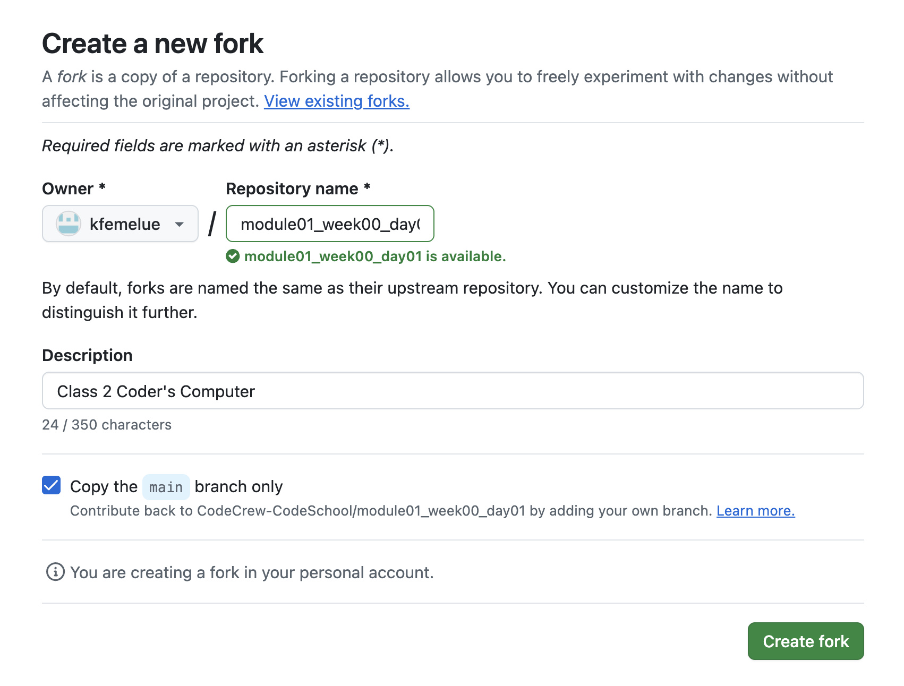

# Power Tools

Having the right tool can make a "hard" thing suddenly much more achievable. Set yourself up for success by getting the right tools and starting to learn them.

## Setup and Documentation

Follow the [Computer Setup Guide](https://curriculum-wlk2.onrender.com/CS_Curriculum/Module_1/Week%2000_HTML%20CSS%20GIT/Week%2000_HTML%20CSS%20GIT_Day01/Setup/) to prepare your development machine for serious coding.

This requires carefully following instructions, and potentially interpreting esoteric error messages. Practice those detail-oriented skills! Take things slowly, and if things go wrong, don't hesitate to get help.

## Requirements

By the time you've completed the guide, you should be able to run the following commands in your terminal and have each report a version number of what's installed.

- `code --version`
- `git --version`

### Submission Instructions

1. Fork this Github Repository by pressing the fork button in the menu bar next to the repo name.

2. Press create fork to create a copy of the repository on your github account.

This will allow you to save your changes to your own copy of the repository, without affecting the original.

3. Clone the repository to your local machine then:

Edit this file by typing your name below this line. git commit and git push the change back to github. 
**NOTE:** Submit a link to your fork on github to the submission box on Schoology.

Your Name Here: ___Maynard Anthony 2
